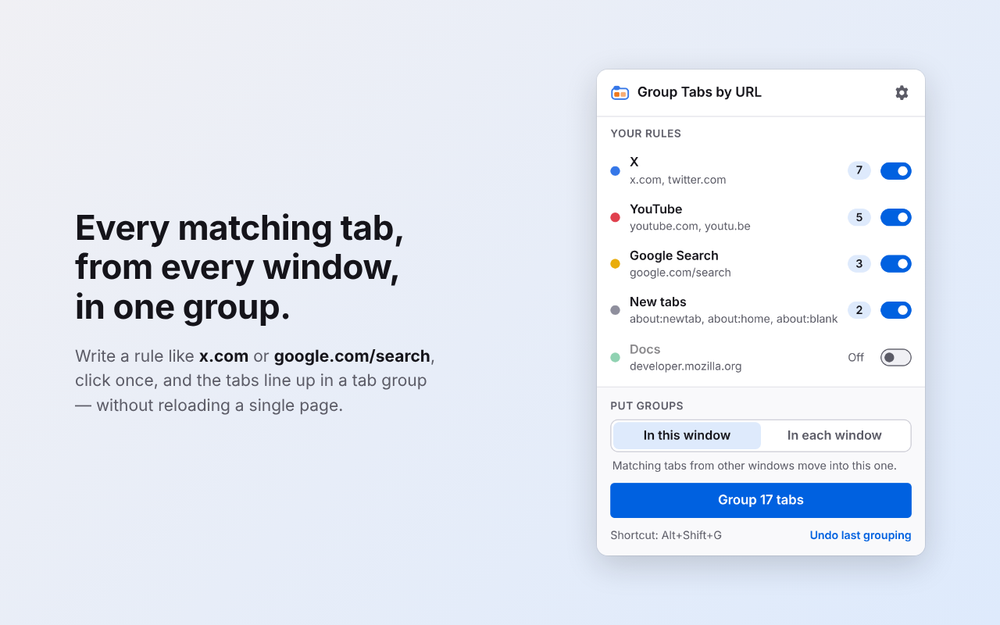
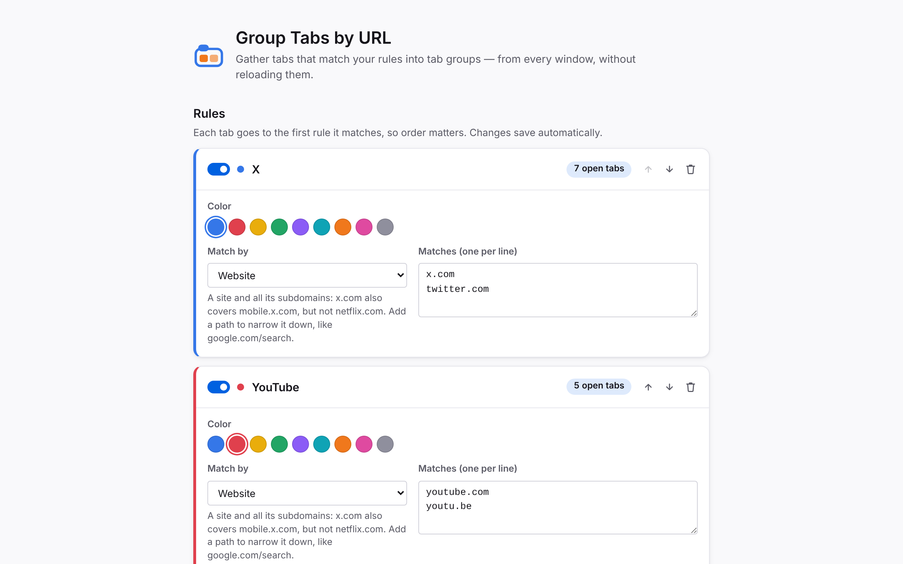

# Group Tabs by URL

A Firefox add-on that collects every tab whose address matches your rules into tidy, named **tab groups**.

| Popup | Settings |
|---|---|
|  |  |

## Features

- **One click (or <kbd>Alt</kbd>+<kbd>Shift</kbd>+<kbd>G</kbd>)** groups all matching tabs.
- **Group once, without a rule.** Type part of an address in the popup's top box, check the preview, and group just those tabs. Nothing is saved.
- **Rules that understand websites.** A *Website* rule for `x.com` matches `x.com` and `mobile.x.com` but never `netflix.com`. Add a path to narrow it down, such as `google.com/search`.
- **Four match types:** Website, Address contains, Address starts with, and Regular expression.
- **Works across windows.** Gather matches into the current window, or group them inside each window.
- **Undo.** Puts every tab back in its old window, position and group. If a group was emptied, it's recreated.
- **Right-click a tab** and choose *Group all tabs from example.com* or *Add a rule for example.com*. On a subdomain such as `en.wikipedia.org` you can also pick the whole site: *Group all tabs from wikipedia.org and its subdomains*.
- **Optional auto-grouping** while you browse. It only acts inside the same window and never touches groups you made yourself.
- **Live counts** show how many open tabs each rule would catch before you click anything.
- **Import and export** rules as JSON.
- Light and dark themes, keyboard accessible, and fully translatable.
- **Private by design:** no data collection, no network requests, no remote code.

Requires **Firefox 140 or newer** on desktop. Firefox for Android doesn't support tab groups.

## How matching works

Rules are checked from top to bottom, and each tab goes to the **first** enabled rule it matches. The rule's name becomes the tab group's title. If a group with that title already exists in the target window, tabs are added to it instead of creating a duplicate.

| Match type | Example | Matches | Doesn't match |
|---|---|---|---|
| Website | `x.com` | `https://x.com/home`, `https://mobile.x.com/…` | `https://netflix.com`, `https://example.com/?ref=x.com` |
| Website + path | `google.com/search` | `https://www.google.com/search?q=…` | `https://www.google.com/maps` |
| Address contains | `/search?q=` | any address containing that text | — |
| Address starts with | `about:newtab` | `about:newtab` | `https://x.com/about:newtab` |
| Regular expression | `^https://(www\.)?google\.[a-z.]+/search` | Google search in every country | — |

All matching ignores case.

## Install for development

1. Open `about:debugging#/runtime/this-firefox` in Firefox.
2. Click **Load Temporary Add-on…** and choose `extension/manifest.json`.

If you have Node.js, you can use Mozilla's `web-ext` tool instead:

```sh
npm install
npm start          # launches Firefox with the add-on loaded and auto-reloads on changes
npm test           # unit + engine tests (Node's built-in test runner, no extra deps)
npm run lint       # Mozilla's add-on linter
npm run build      # creates dist/group_tabs_by_url-<version>.zip for addons.mozilla.org
npm run screenshots  # regenerates docs/screenshots (needs a Chromium binary)
```

## Project layout

```
extension/                 ← everything that ships; this folder is the add-on
  manifest.json
  _locales/en/messages.json   all user-facing text
  background/background.js    event page: messages, shortcuts, menus, auto-group
  shared/rules.js             rule model + URL matching (pure, unit-tested)
  shared/grouping.js          grouping engine: group, undo, auto-group
  shared/settings.js          storage helper
  shared/i18n.js, ui.css      shared by popup and settings page
  popup/                      toolbar popup
  options/                    settings page
  icons/icon.svg
test/                      ← Node tests, incl. an in-memory model of Firefox tabs/groups
scripts/                   ← screenshot tooling (not shipped)
docs/                      ← store listing text, reviewer notes, publishing guide
```

There is **no build step**. The files in `extension/` are exactly what runs in Firefox: no bundler, no minifier and no third-party libraries.

## Permissions

| Permission | Why |
|---|---|
| `tabs` | To read tab addresses so they can be matched against your rules. Firefox shows this as *Access browser tabs*. |
| `tabGroups` | To name, colour and collapse the groups it creates. |
| `storage` | To save your rules on your computer. |
| `menus` | For the right-click items on tabs and on the toolbar button. |

No host permissions are requested. The add-on can't read or change page content.

## Privacy

The add-on collects nothing and sends nothing anywhere. Your rules are stored only in your Firefox profile. See [PRIVACY.md](PRIVACY.md).

## Translating

Copy `extension/_locales/en/` to a folder named after your language code (for example `_locales/de/`) and translate the `message` values. Each entry has a `description` explaining where the text appears. Keep `$PLACEHOLDERS$` unchanged.

## License

[MIT](LICENSE)
